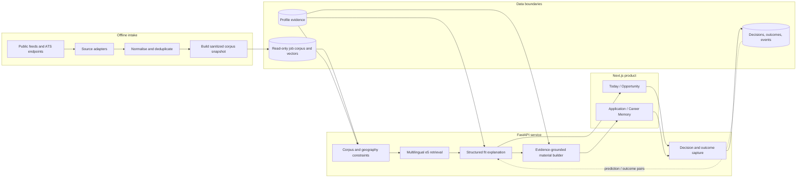

# Career OS — public case study

Career OS is a private job-search product I built while looking for software roles in Germany. It ranks a limited set of jobs, shows why each one does or does not fit, prepares application material from approved profile facts, and keeps the later outcome attached to the original decision.

> I opened this public repository in October 2026. The product itself was developed in private repositories; GitHub's repository creation date is the publication date of this case study, not the start of the project.

[](https://github.com/rishabhlakra/career-os-engineering/actions/workflows/verify.yml)

The application source is private because it contains profile data, application history, source corpora, and ranking logic I do not want to publish as a template. This repository is the public engineering record: architecture, infrastructure, data contracts, evaluation summaries, and sanitized artifacts generated from the private build.

## Main workflows

I kept the interface to four rooms. Each one answers one question.

| Room | Question | Product behaviour |
|---|---|---|
| **Today** | What deserves attention now? | A finite ranked set; weak results are not added just to fill the page. |
| **Opportunity** | Is this role actually viable? | Evidence, seniority, language, and gaps remain separate instead of collapsing into one score. |
| **Application** | Can I send this without overstating my background? | A resume variant, cover letter, and recruiter note are assembled from approved profile evidence. |
| **Career Memory** | What happened, and what should change? | Decisions, applications, outcomes, and the prediction made at decision time are stored together. |

The product does not submit applications. It prepares the work and leaves the final action with the user.

## System overview



The prepared private-beta deployment keeps the corpus and personal state apart. The API reads a corpus-only SQLite snapshot from a private volume, while Supabase Postgres stores authenticated user state behind row-level security. The embedding model is packaged with the API image so startup does not depend on downloading it at runtime.

[Read the infrastructure notes →](docs/infrastructure.md)

## Private implementation map

The source stays private, but the public architecture maps to concrete modules in the working repositories.

| Concern | Private implementation |
|---|---|
| ATS ingestion | `pipeline/ingestion/personio.py`, `greenhouse.py`, `lever.py`, `recruitee.py`, `smartrecruiters.py`, `ashby.py`, `arbeitnow.py`, `ba.py` |
| Retrieval | `pipeline/match/embeddings.py`, `pipeline/relevance.py`, `pipeline/ranking_service.py` |
| Fit context | `pipeline/seniority.py`, `pipeline/language_gate.py`, `pipeline/eligibility.py`, `pipeline/profile_context.py` |
| Application material | `pipeline/tailoring.py`, `pipeline/resume_template_engine.py`, `pipeline/trust.py` |
| API | `api/main.py` and route modules for discovery, jobs, profiles, packs, and statistics |
| User state | `pipeline/supabase_store.py` plus row-level-security policies in Supabase |
| Evaluation | fixed-profile scripts under `scripts/` and scorecards under `eval/` |
| Web client | Next.js routes for Today, Opportunity, Application, Career Memory, onboarding, and authentication |

## Engineering work

### Retrieval that respects hard context

The ranker uses multilingual e5 embeddings for semantic retrieval, then applies seniority and language context before deciding whether a role is a match, a credible reach, or merely related. The browser never receives the raw similarity value or ranking weights. It receives the evidence, the practical gap, and a plain-language explanation.

[Read the relevance design →](docs/relevance-and-fit.md)

### Application material with a claim boundary

Profile evidence is structured into roles, dates, skills, projects, education, constraints, and resume-safe claims. Job-description terms can affect selection only when the profile supports them. The writer is deterministic, and a lint pass checks unsupported tools, quantities, and claims before a pack can be marked ready.

[Read the material pipeline →](docs/application-materials.md)

### A migration checked beyond “the script completed”

The live migration report lists 12,669 rows across profiles, skills, jobs, job state, actions, and rejection events. Verification included per-table parity, a ten-job signature spot check, timestamp conversion, orphan handling, and a two-user row-level-security isolation test.

[Inspect the sanitized migration artifact →](artifacts/migration/verification.json)

### Evaluation setup

The generalisation harness crosses four synthetic profiles with five role families and strong, stretch, and weak fit cases. A later readiness analysis identified six pack-ready cells; five cleared all three material bars. One remaining failure is kept in the record rather than averaged away.

[Inspect the evaluation summary →](artifacts/evaluation/pack-ready-scorecard.json)

## Evidence index

These are development artifacts, not customer or production-usage claims.

| Area | Recorded result | Public artifact |
|---|---:|---|
| Ingestion snapshot | 1,943 jobs · 527 companies · 8 adapter types | [snapshot.json](artifacts/ingestion/snapshot.json) |
| Live data migration | 12,669 rows listed in the migration report | [verification.json](artifacts/migration/verification.json) |
| Generalisation harness | 24 profile/job cells | [pack-ready-scorecard.json](artifacts/evaluation/pack-ready-scorecard.json) |
| Pack-ready analysis | 5 of 6 cells cleared all material bars | [pack-ready-scorecard.json](artifacts/evaluation/pack-ready-scorecard.json) |
| Fixed regression sentinel | 9 files byte-identical | [regression-sentinel.json](artifacts/evaluation/regression-sentinel.json) |
| Pre-user security review | 3 material findings fixed before beta exposure | [security-review.json](artifacts/security/security-review.json) |
| Public API boundary | Score-free, evidence-bearing fit payload | [public-fit-payload.schema.json](artifacts/contracts/public-fit-payload.schema.json) |

The repository runs a small verifier in CI. It parses every public artifact, recomputes the migration total, checks score bounds and evaluation arithmetic, and validates local documentation links.

## Repository guide

```text
artifacts/
  contracts/       Public response schema
  evaluation/      Readiness and regression summaries
  ingestion/       Sanitized corpus snapshot
  migration/       Per-table migration counts and checks
  security/        Sanitized pre-user review outcome
docs/
  architecture.md
  application-materials.md
  engineering-decisions.md
  infrastructure.md
  relevance-and-fit.md
  verification.md
scripts/
  verify_public_artifacts.py
```

## Stack

- **Product:** Next.js 16, React 19, TypeScript, Tailwind CSS, Radix UI
- **API:** Python, FastAPI, Pydantic
- **Search:** Sentence Transformers, multilingual e5 embeddings, vector similarity
- **State:** Supabase Auth, PostgreSQL, row-level security, corpus-only SQLite snapshot
- **Prepared beta delivery:** Dockerized API for Railway, Next.js frontend for Vercel
- **Verification:** Vitest, Playwright, integration tests, fixed evaluation matrices, deterministic regression comparison

## What is not published

This repository does not contain the production source, resumes, application records, prompts, ranking weights, private schemas, source corpus, secrets, or deployment credentials. The artifacts are deliberately narrow enough to inspect the engineering without recreating the private product or exposing personal data.

## Current limitations

- The corpus figures describe recorded development snapshots, not live throughput.
- The evaluation harness is internal and synthetic; it is useful for regression, not an external quality benchmark.
- Byte-identical output proves repeatability, not writing quality.
- Prediction/outcome pairs are captured for later calibration; there is no trained outcome model yet.
- The public repository is a case study, not a runnable copy of Career OS.

More detail is in [verification.md](docs/verification.md) and [engineering-decisions.md](docs/engineering-decisions.md).

Copyright © 2026 Rishabh Lakra. See [COPYRIGHT.md](COPYRIGHT.md).
