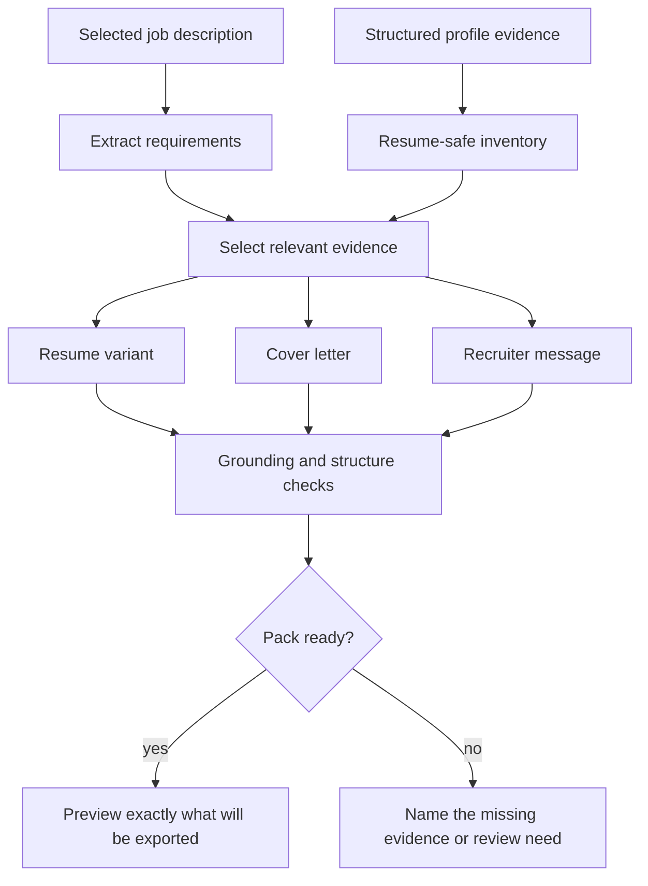

# Application materials

The application pipeline is built around one rule: a job description may change emphasis, but it may not create candidate evidence.

## Evidence model

The profile stores experience, projects, education, dates, languages, constraints, and skills as structured entries. Skills also carry a resume-safety decision. This prevents a tool mentioned in notes or learning plans from appearing as shipped experience.

## Pack flow

The writer is deterministic. The same profile and job produce the same material unless the implementation or evidence changes.

## Readiness gate

Relevance and writing readiness are separate states. The readiness analysis uses two minimums:

- enough approved profile evidence to write from;
- enough job-description text to tailor against.

In the recorded analysis, ten visible evaluation cells were reviewed. Six met both readiness conditions; five of those six cleared the cover-letter, resume, and recruiter-message bars. The remaining pack-ready failure is retained in the public scorecard.

## Checks

The material path checks:

- technologies against the resume-safe inventory;
- quantified claims for a supporting artifact;
- job-specific language against candidate evidence;
- weak-fit cases for restraint;
- minimum content and structure by material type;
- unexpected output changes against fixed regression fixtures.

The nine-file sentinel covers three material types across three fixed profile/job fixtures. It verifies repeatability after changes; it does not replace the content-quality checks.

## Why not an unrestricted LLM writer

An unrestricted generator is easy to demo and difficult to trust. It can add plausible tools, smooth over weak evidence, or change wording after a model update. Career OS uses applied AI for retrieval and fit, while keeping the final claim-producing path deterministic and inspectable.

That choice reduces stylistic variety. For a system preparing personal claims, the traceability is worth the trade.
