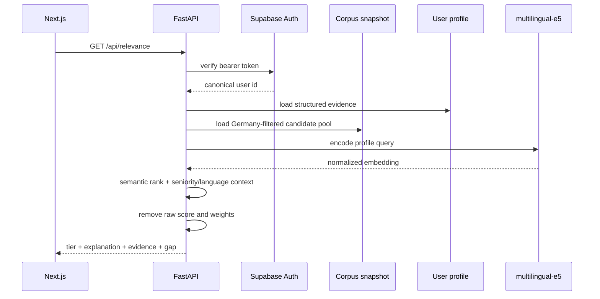
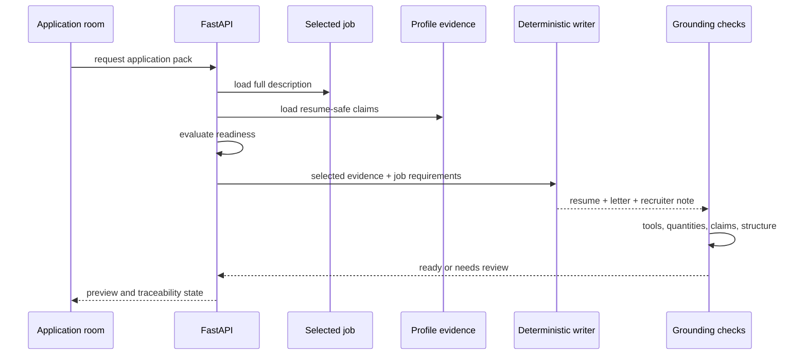

# Architecture

Career OS has four operating boundaries:

1. **offline intake** collects and normalises job data;
2. **the API** owns identity, retrieval, fit policy, and workflow transitions;
3. **the product UI** presents one decision at a time;
4. **the evaluation toolchain** checks relevance and material quality outside the request path.

The separation matters because corpus work is bursty and failure-prone, while the product should remain responsive and predictable.

## Component map

| Component | Responsibility | Deliberately does not own |
|---|---|---|
| Source adapters | Fetch provider data and emit a common job shape | Ranking or user state |
| Normalisation layer | Clean dates, locations, company names, role text, and source identity | Candidate-specific decisions |
| Corpus snapshot | Store jobs and precomputed embeddings for read-heavy retrieval | Personal profile or application history |
| FastAPI service | Verify identity, rank jobs, explain fit, build material, capture workflow events | Browser presentation |
| Supabase | Authentication and user-scoped state with row-level security | Source ingestion |
| Next.js product | The four-room workflow and final user controls | Ranking weights or claim generation |
| Evaluation harness | Run fixed profiles, jobs, material checks, and regression comparisons | Live product state |

## Ranked-list request

The user ID comes from the verified token rather than a client-supplied query parameter. A no-token development identity exists for the founder's local workflow, but founder-local endpoints are blocked for authenticated external users.

## Application-pack request

Material readiness is separate from relevance. A job can be relevant enough to review but lack enough description or profile evidence for safe tailored material.

## Event and outcome capture

A decision event stores the fit prediction available at that moment. When an outcome arrives later, the two records can be compared without reconstructing the old model state.

The stored prediction snapshot contains internal fields such as fit class, similarity, demand context, and gap count. Those fields support later calibration but are not shown as an authoritative score in the UI.

## Private/public split

The public repository contains data contracts, aggregate evaluation summaries, and architecture notes. It omits the source corpus, production code, weighting logic, prompts, personal records, private schemas, and deployment secrets.
