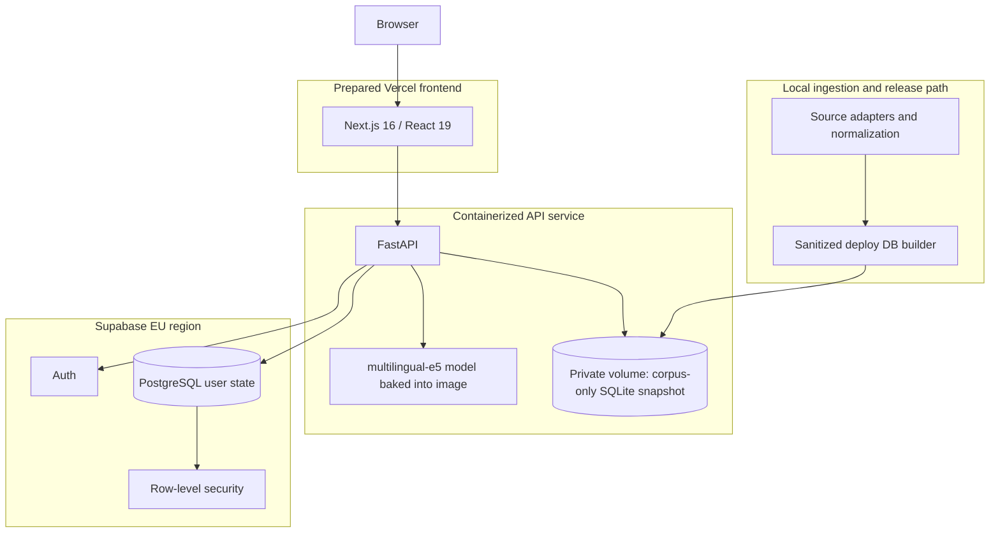

# Infrastructure

This document describes the private-beta deployment shape prepared for Career OS. It is an architecture record, not a claim of public production traffic.

## Deployment map

## Why the data is split

The job corpus is large, read-heavy, and replaceable. Personal state is small, write-heavy, and sensitive. Keeping them separate produces a clearer boundary:

- the corpus snapshot contains jobs and embeddings only;
- profiles, decisions, outcomes, and events live in user-scoped PostgreSQL tables;
- personal notes, application history, and local founder state are excluded from the deploy artifact.

The deploy database builder clears personal tables and verifies that corpus and embedding counts remain unchanged before release.

## Model packaging

The multilingual e5 model is packaged into the backend image. This avoids a runtime download during a cold start and makes the deployed model version explicit. The cost is a larger image and a higher memory floor for the API container.

## Authentication and authorization

Supabase Auth issues the user token. FastAPI verifies it with Supabase and derives the canonical user ID from the verified response. The client cannot select another user's ID to read their state.

PostgreSQL row-level security adds a second boundary below the API. A temporary two-user test confirmed that each identity could read its own records and not the other's.

## Pre-user security review

The review caught three material problems before beta exposure:

1. a SPA fallback path that could resolve outside its distribution directory;
2. founder-local endpoints that were reachable from an authenticated multi-user path;
3. a wildcard CORS configuration combined with credentials.

The fixes added path containment, explicit founder-only route protection, and environment-driven CORS origins. A sanitized result is published at [security-review.json](../artifacts/security/security-review.json).

## Release checks

Before a beta deploy, the prepared runbook requires:

- a corpus-only database build with personal tables empty;
- secrets set in the hosting UI rather than committed files;
- the frontend origin set explicitly for CORS;
- auth redirect URLs set to the deployed frontend;
- health, anonymous preview, signed-in ranking, entitlement, traversal, and unauthorized-route smoke checks.

## Known infrastructure tradeoffs

- Token verification currently adds a Supabase network round trip to authenticated requests.
- The corpus refresh is a release operation rather than a continuously scheduled production pipeline.
- The model and vectors require more memory than a small serverless function can provide.
- The private-beta shape prioritizes a clear trust boundary over distributed scale.
