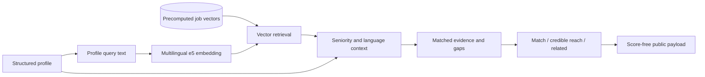

# Relevance and fit

The relevance problem is not “find jobs containing the same tools as the resume.” A role can share keywords and still be wrong because of level, geography, language, employment type, or the kind of work behind those tools.

## Pipeline

### 1. Corpus constraints

The intake path keeps the corpus broad across software, data/ML, QA, DevOps/cloud, and infrastructure-shaped roles. Out-of-scope role families and non-Germany locations are removed before candidate-specific ranking.

### 2. Semantic retrieval

The profile and jobs are encoded with the same multilingual e5 model. Job vectors are precomputed, while the profile query is encoded at request time. Normalized vector similarity provides the main “work resembles work” signal.

### 3. Human context

The semantic result is interpreted alongside:

- full-time-relevant experience rather than title inflation;
- the job's seniority signal and confidence;
- language requirements compared with the candidate's stated level;
- role-family evidence in the candidate's inventory;
- the number and closability of missing requirements.

Language is treated as information and a ranking penalty, not an automatic hide. The user can still decide to apply despite it.

### 4. Presentation policy

The API exposes a small, evidence-bearing object:

- a coarse tier;
- a plain-language explanation;
- matching technologies or experience;
- the most actionable gap;
- any language note.

It removes raw similarity, weights, and the internal seniority label. The schema is published at [public-fit-payload.schema.json](../artifacts/contracts/public-fit-payload.schema.json).

## What failed before this design

### Keyword overlap as the main fit signal

Alias handling fixed obvious misses such as PostgreSQL/Postgres and REST/RESTful, but it improved both the matched and required sides of the calculation. Overall coverage did not materially improve. Keywords remained useful for explanation, but not as the primary relevance model.

### One blended score

A single number hid the difference between “similar work,” “wrong level,” and “language blocker.” It also looked more precise than the evidence justified. The product now keeps those concerns separate and shows the user the parts that can support a decision.

### Family widening without profile evidence

Adding more job families increased coverage but also surfaced roles with no credible profile support. A profile-aware family gate now requires evidence before a family can appear automatically. Roles a user already selected remain visible even if later policy changes.

## Honest limits

Semantic similarity still compresses nuance, and requirement extraction still depends on the quality of the job description. The system therefore distinguishes “visible” from “material-ready” and keeps related roles visibly separate from exact matches.
